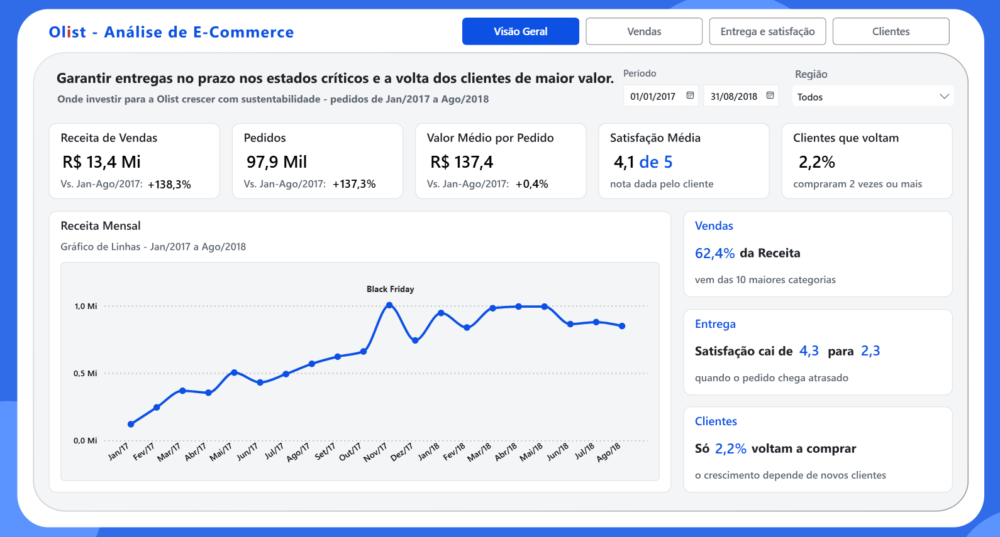
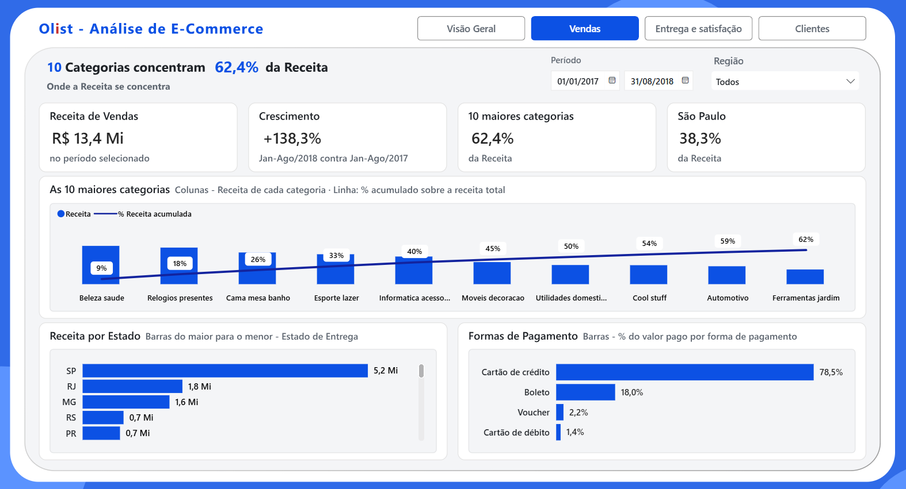
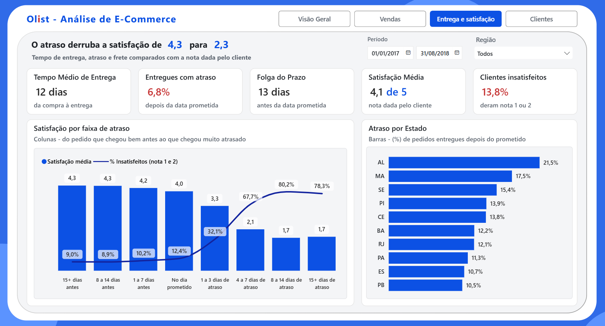
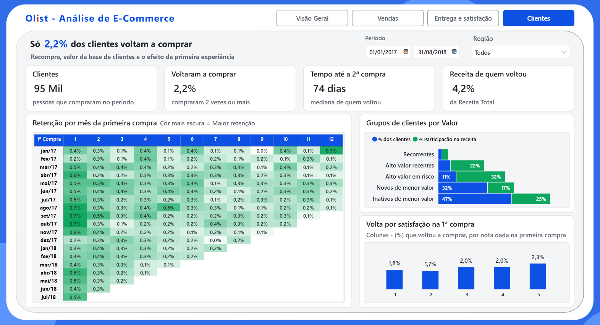

# Olist: onde investir para crescer com sustentabilidade

Estudo de caso do Tech Challenge (Fase 1) da pós-graduação em Data Analytics. O projeto transforma a base pública de e-commerce da Olist num relatório executivo para investidores e acionistas, com recomendações de investimento. A análise cobre 97,9 mil pedidos feitos entre janeiro de 2017 e agosto de 2018, que somam R$ 13,4 milhões em receita.

## Entregáveis

| Entregável | Arquivo |
| --- | --- |
| Relatório executivo (PDF) | [reports/Relatorio_Executivo_Olist.pdf](reports/Relatorio_Executivo_Olist.pdf) |
| Apresentação executiva (PPTX) | [reports/Apresentacao_Executiva_Olist.pdf](reports/Apresentacao_Executiva_Olist.pdf) |
| Painel no Power BI (PBIX) | [powerbi/Challenge_Ecommerce.pbix](powerbi/Challenge_Ecommerce.pbix) |
| Vídeo executivo (até 5 min) | https://drive.google.com/file/d/1lNQ2NJEfjGYURY-8kOJm2TxWy9gfSgFd/view?usp=sharing |
| Prints do painel | [docs/img](docs/img) |

## Temas escolhidos

- Desempenho comercial
- Logística e satisfação
- Retenção e valor do cliente

## Pergunta do estudo

**Onde a Olist deve priorizar seus próximos investimentos, entre logística, retenção de clientes e portfólio de categorias e regiões, para sustentar o crescimento da receita?**

Pergunta norteadoras:

P1. Como a receita evoluiu entre 2017 e 2018 e onde ela está concentrada?
P2. Quanto o atraso na entrega se relaciona com a insatisfação do cliente, e onde o problema é mais grave?
P3. Os clientes voltam a comprar, e a primeira experiência influencia essa volta?

## Resposta e principais resultados

**Recomendação:** Garantir entregas no prazo nos estados críticos e a volta dos clientes de maior valor.

- **A receita dobrou, mas parou de crescer.** De janeiro a agosto, a receita de 2018 foi 138% maior que a de 2017, puxada pelo número de pedidos (+137%), com o valor médio por pedido estável (+0,4%). Em 2018, a receita mensal ficou parada entre R$ 0,8 e 1,0 milhão.
- **O atraso é raro, mas derruba a satisfação.** Só 6,8% dos pedidos atrasam, mas neles a nota média cai de 4,3 para 2,3. O atraso chega a 21,5% em Alagoas e a 12,1% no Rio de Janeiro, segundo maior mercado.
- **Quase ninguém volta a comprar.** Só 2,2% dos clientes compraram mais de uma vez. O grupo de alto valor que está há mais de seis meses sem comprar reúne 11% dos clientes e 32% da receita.

## Alavancas recomendadas

- Reduzir o atraso nos estados críticos, começando pelo Rio de Janeiro e pelo Nordeste.
- Reativar os clientes de alto valor que pararam de comprar.
- Proteger a primeira compra, com prazo prometido mais preciso e contato depois da entrega. 

**O detalhamento está no relatório executivo.**

## Método (CRISP-DM)

| Fase | O que foi feito | Onde está |
| --- | --- | --- |
| 1. Entendimento do negócio | Público, pergunta do estudo, perguntas norteadoras e hipóteses | [docs/entendimento_negocio.md](docs/entendimento_negocio.md) |
| 2. Entendimento dos dados | Exploração das tabelas: volumes, chaves, nulos, repetições e período | [notebooks/exploracao.ipynb](notebooks/exploracao.ipynb) |
| 3. Preparação dos dados | Regras de tratamento, modelo estrela e validações automáticas | [src/transformacoes.py](src/transformacoes.py) |
| 4. Modelagem | Medidas, grupos de clientes e retenção por mês da 1ª compra | Painel no Power BI |
| 5. Avaliação | Conciliação entre script e painel e teste das hipóteses | [docs/qualidade_dados.md](docs/qualidade_dados.md) |
| 6. Implantação | Relatório, apresentação, vídeo e este repositório | Pasta reports/ |

**Fluxo dos dados:** CSVs da Olist (`data/raw`) → exploração no notebook → tratamento no script Python → tabelas tratadas (`data/processed`) → painel no Power BI → relatório, apresentação e vídeo.

## Painel

Quatro páginas, com filtros de período e região: **Visão geral**, **Vendas**, **Entrega e satisfação** e **Clientes**.

## Estrutura do repositório

| Pasta ou arquivo | Conteúdo |
| --- | --- |
| `data/raw/` | CSVs originais da Olist (não versionados) |
| `data/processed/` | Tabelas tratadas geradas pelo script |
| `docs/` | Documentação: negócio, métricas, dicionário de dados e qualidade |
| `docs/img/` | Prints do painel |
| `layout/` | Layout das 4 páginas do painel, criado no Figma |
| `notebooks/exploracao.ipynb` | Exploração dos dados |
| `src/transformacoes.py` | Tratamento dos dados e geração do modelo estrela |
| `powerbi/` | Painel do Power BI (`Challenge_Ecommerce.pbix`) |
| `reports/figuras/` | Gráficos gerados pelo notebook |
| `requirements.txt` | Bibliotecas Python do projeto |

## Como reproduzir

1. Baixe os dados no Kaggle e coloque os CSVs em `data/raw/`.
2. Crie o ambiente e instale as bibliotecas (comandos para Windows).
3. Gere as tabelas tratadas com `python src/transformacoes.py`. O script valida os dados e para com erro se alguma regra falhar. Ao final, grava 8 arquivos em `data/processed/`.
4. Abra `Challenge_Ecommerce.pbix`. Se a pasta do projeto for outra, ajuste o caminho em Transformar dados › Configurações da fonte de dados e clique em Atualizar.

## Dados

- **Fonte:** Olist, [Brazilian E-Commerce Public Dataset](https://www.kaggle.com/datasets/olistbr/brazilian-ecommerce), no Kaggle. Dados reais e anonimizados.
- **Data do download:** 20/10/2026.
- **Arquivos usados (em `data/raw/`):** `olist_orders_dataset.csv`, `olist_order_items_dataset.csv`, `olist_order_payments_dataset.csv`, `olist_order_reviews_dataset.csv`, `olist_customers_dataset.csv`, `olist_sellers_dataset.csv`, `olist_products_dataset.csv` e `product_category_name_translation.csv`. O arquivo de geolocalização não é usado.

## Governança

- [Entendimento do negócio](docs/entendimento_negocio.md): pergunta, hipóteses e resultados, escopo e limitações.
- [Definições de métricas](docs/definicoes_metricas.md): a regra de cada indicador do painel.
- [Dicionário de dados](docs/dicionario_dados.md): tabelas de origem e do modelo, com suas colunas.
- [Qualidade dos dados e decisões](docs/qualidade_dados.md): problemas encontrados, tratamentos, validações e decisões de escopo.

## Ferramentas

Python (pandas, NumPy e Matplotlib) no VS Code, Power BI Desktop e Figma.

## Autor

Vinícius Gomes - Pós-graduação em Data Analytics - Tech Challenge Fase 1