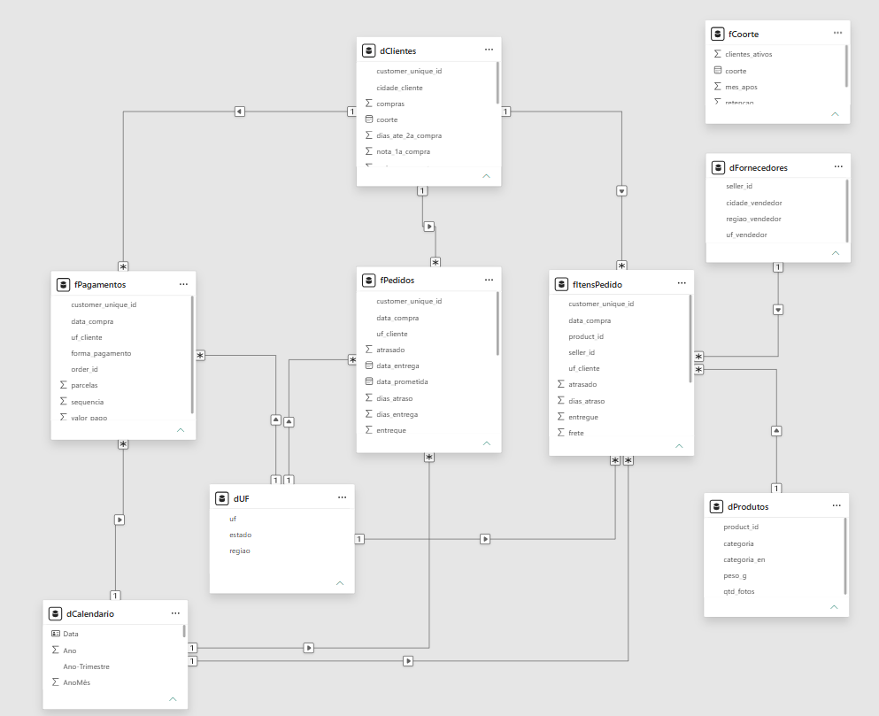

# Dicionário de dados

A Parte 1 descreve as tabelas originais da Olist. A Parte 2 descreve as tabelas tratadas que o script `src/transformacoes.py` grava em `data/processed/` e que formam o modelo do Power BI. As regras de cálculo estão em [definicoes_metricas.md](definicoes_metricas.md).

## Parte 1. Tabelas de origem

### orders — `olist_orders_dataset.csv` (1 linha por pedido)

| Coluna | Tipo | Descrição |
| --- | --- | --- |
| order_id | texto | Identificador do pedido (chave) |
| customer_id | texto | Identificador do cliente no pedido; muda a cada pedido |
| order_status | texto | Situação do pedido (delivered, shipped, canceled, unavailable, invoiced, processing, created, approved) |
| order_purchase_timestamp | data e hora | Momento da compra |
| order_approved_at | data e hora | Aprovação do pagamento |
| order_delivered_carrier_date | data e hora | Entrega do pedido à transportadora |
| order_delivered_customer_date | data e hora | Entrega ao cliente |
| order_estimated_delivery_date | data e hora | Data de entrega prometida na compra (sempre às 00:00) |

### order_items — `olist_order_items_dataset.csv` (1 linha por item do pedido)

| Coluna | Tipo | Descrição |
| --- | --- | --- |
| order_id | texto | Pedido (chave junto com order_item_id) |
| order_item_id | inteiro | Número sequencial do item dentro do pedido |
| product_id | texto | Produto vendido |
| seller_id | texto | Vendedor do item |
| shipping_limit_date | data e hora | Prazo para o vendedor entregar o item à transportadora |
| price | decimal | Preço do item (R$) |
| freight_value | decimal | Frete do item (R$); num pedido com vários itens, o frete é rateado entre eles |

### order_payments — `olist_order_payments_dataset.csv` (1 linha por pagamento do pedido)

| Coluna | Tipo | Descrição |
| --- | --- | --- |
| order_id | texto | Pedido (chave junto com payment_sequential) |
| payment_sequential | inteiro | Sequência do pagamento quando o pedido usa mais de um meio |
| payment_type | texto | Meio de pagamento (credit_card, boleto, voucher, debit_card, not_defined) |
| payment_installments | inteiro | Número de parcelas |
| payment_value | decimal | Valor pago nessa linha (R$) |

### order_reviews — `olist_order_reviews_dataset.csv` (1 linha por avaliação)

| Coluna | Tipo | Descrição |
| --- | --- | --- |
| review_id | texto | Identificador da avaliação (pode se repetir entre pedidos) |
| order_id | texto | Pedido avaliado |
| review_score | inteiro | Nota de 1 a 5 |
| review_comment_title | texto | Título do comentário (opcional) |
| review_comment_message | texto | Comentário (opcional) |
| review_creation_date | data e hora | Envio da pesquisa de satisfação ao cliente |
| review_answer_timestamp | data e hora | Resposta do cliente |

### customers — `olist_customers_dataset.csv` (1 linha por customer_id)

| Coluna | Tipo | Descrição |
| --- | --- | --- |
| customer_id | texto | Identificador do cliente no pedido (chave; liga com orders) |
| customer_unique_id | texto | Identificador único da pessoa; usado para contar clientes e recompra |
| customer_zip_code_prefix | texto | 5 primeiros dígitos do CEP |
| customer_city | texto | Cidade |
| customer_state | texto | UF |

### sellers — `olist_sellers_dataset.csv` (1 linha por vendedor)

| Coluna | Tipo | Descrição |
| --- | --- | --- |
| seller_id | texto | Identificador do vendedor (chave) |
| seller_zip_code_prefix | texto | 5 primeiros dígitos do CEP |
| seller_city | texto | Cidade |
| seller_state | texto | UF |

### products — `olist_products_dataset.csv` (1 linha por produto)

| Coluna | Tipo | Descrição |
| --- | --- | --- |
| product_id | texto | Identificador do produto (chave) |
| product_category_name | texto | Categoria em português |
| product_name_lenght | inteiro | Número de caracteres do nome do produto (grafia original da coluna) |
| product_description_lenght | inteiro | Número de caracteres da descrição (grafia original da coluna) |
| product_photos_qty | inteiro | Quantidade de fotos publicadas |
| product_weight_g | inteiro | Peso em gramas |
| product_length_cm | inteiro | Comprimento em centímetros |
| product_height_cm | inteiro | Altura em centímetros |
| product_width_cm | inteiro | Largura em centímetros |

### category_translation — `product_category_name_translation.csv` (1 linha por categoria)

| Coluna | Tipo | Descrição |
| --- | --- | --- |
| product_category_name | texto | Categoria em português (chave) |
| product_category_name_english | texto | Categoria em inglês |

### geolocation — `olist_geolocation_dataset.csv` (não usada no estudo)

Tem vários pontos por prefixo de CEP, com latitude, longitude, cidade e UF. Ficou fora do escopo, como registrado em [qualidade_dados.md](qualidade_dados.md).

## Parte 2. Modelo do Power BI

Modelo estrela com quatro tabelas de fatos (prefixo `f`) e cinco dimensões (prefixo `d`). Os arquivos saem com separador `;` e decimal `,`.

| Tabela no Power BI | Arquivo em `data/processed/` | Uma linha por | Chave |
| --- | --- | --- | --- |
| fPedidos | fato_pedidos.csv | Pedido | order_id |
| fItensPedido | fato_itens.csv | Item de pedido | order_id + order_item_id |
| fPagamentos | fato_pagamentos.csv | Pagamento do pedido | order_id + sequencia |
| fCoorte | agg_retencao_coorte.csv | Mês da 1ª compra × meses depois (1 a 12) | coorte + mes_apos |
| dCalendario | montada diretamente utilizando M no Power BI | data |
| dClientes | dim_cliente.csv | Cliente (pessoa) | customer_unique_id |
| dProdutos | dim_produto.csv | Produto | product_id |
| dFornecedores | dim_vendedor.csv | Vendedor | seller_id |
| dUF | dim_uf.csv | Estado | uf |

**Relacionamentos:** todos de um para muitos, com filtro em uma única direção.

- dCalendario, pela data da compra, e dClientes e dUF, pelo cliente e pela UF do cliente, filtram fPedidos, fItensPedido e fPagamentos.
- dProdutos e dFornecedores filtram fItensPedido.
- fCoorte não se relaciona com as demais tabelas: a matriz de retenção não varia com os filtros do painel.

### fPedidos — `fato_pedidos.csv`

| Coluna | Tipo | Descrição |
| --- | --- | --- |
| order_id | texto | Pedido (chave) |
| customer_unique_id | texto | Cliente |
| data_compra | data | Data da compra |
| uf_cliente | texto | UF do cliente no pedido |
| status | texto | Situação do pedido em português |
| qtd_itens | inteiro | Quantidade de itens |
| receita | decimal | Soma do preço dos produtos (R$), sem frete |
| frete | decimal | Soma do frete dos itens (R$) |
| valor_pago | decimal | Soma dos pagamentos do pedido (R$), com frete e vouchers |
| forma_pagamento | texto | Forma de pagamento de maior valor no pedido |
| parcelas | inteiro | Maior número de parcelas do pedido (0 parcela vira 1) |
| entregue | 0 ou 1 | 1 = entregue, com data de entrega |
| data_entrega | data | Data de entrega ao cliente |
| data_prometida | data | Data de entrega prometida na compra |
| dias_entrega | inteiro | Dias entre a compra e a entrega |
| dias_atraso | inteiro | Data de entrega − data prometida (positivo = atraso) |
| atrasado | 0 ou 1 | 1 = entregue depois da data prometida |
| faixa_atraso | texto | Faixa de atraso (8 faixas) |
| ordem_faixa | inteiro | Ordem das faixas, usada para classificar o eixo |
| nota | inteiro | Nota da avaliação (1 a 5); vazia se não houve avaliação |
| insatisfeito | 0 ou 1 | 1 = nota 1 ou 2 |

### fItensPedido — `fato_itens.csv`

| Coluna | Tipo | Descrição |
| --- | --- | --- |
| order_id | texto | Pedido |
| order_item_id | inteiro | Número do item no pedido |
| product_id | texto | Produto |
| seller_id | texto | Vendedor |
| customer_unique_id | texto | Cliente |
| data_compra | data | Data da compra |
| uf_cliente | texto | UF do cliente |
| preco | decimal | Preço do item (R$) |
| frete | decimal | Frete do item (R$) |
| entregue, atrasado, dias_atraso, nota, insatisfeito | — | Valores do pedido repetidos no item, para cortes por categoria e vendedor |

### fPagamentos — `fato_pagamentos.csv`

| Coluna | Tipo | Descrição |
| --- | --- | --- |
| order_id | texto | Pedido |
| sequencia | inteiro | Sequência do pagamento no pedido |
| customer_unique_id | texto | Cliente |
| data_compra | data | Data da compra |
| uf_cliente | texto | UF do cliente |
| forma_pagamento | texto | Cartão de crédito, Boleto, Voucher, Cartão de débito ou Não definido |
| parcelas | inteiro | Número de parcelas (0 parcela vira 1) |
| valor_pago | decimal | Valor pago nessa linha (R$) |

### fCoorte — `agg_retencao_coorte.csv`

| Coluna | Tipo | Descrição |
| --- | --- | --- |
| coorte | texto | Mês da 1ª compra (AAAA-MM) |
| mes_apos | inteiro | Meses depois da 1ª compra (1 a 12) |
| tamanho_coorte | inteiro | Clientes cuja 1ª compra foi nesse mês |
| clientes_ativos | inteiro | Clientes desse grupo que compraram de novo no mês indicado |
| retencao | decimal | clientes_ativos ÷ tamanho_coorte |

### dClientes — `dim_cliente.csv`

| Coluna | Tipo | Descrição |
| --- | --- | --- |
| customer_unique_id | texto | Cliente (chave) |
| uf_cliente, cidade_cliente | texto | UF e cidade do pedido mais recente |
| primeira_compra, segunda_compra, ultima_compra | data | Datas da 1ª, da 2ª e da última compra |
| compras | inteiro | Datas distintas de compra |
| pedidos | inteiro | Número de pedidos |
| valor | decimal | Receita do cliente no período (R$) |
| dias_ate_2a_compra | inteiro | Dias entre a 1ª e a 2ª compra |
| nota_1a_compra | inteiro | Nota da 1ª compra (a menor, se houve mais de um pedido no dia) |
| recencia_dias | inteiro | Dias entre a última compra e 31/08/2018 |
| voltou | texto | Sim se comprou em 2 ou mais datas |
| segmento | texto | Grupo de clientes (regras em [definicoes_metricas.md](definicoes_metricas.md)) |
| ordem_segmento | inteiro | Ordem dos grupos, usada para classificar |
| coorte | texto | Mês da 1ª compra (AAAA-MM) |

### dProdutos — `dim_produto.csv`

| Coluna | Tipo | Descrição |
| --- | --- | --- |
| product_id | texto | Produto (chave) |
| categoria | texto | Categoria em português; "Sem categoria" quando ausente |
| categoria_en | texto | Categoria em inglês; usa o nome em português quando não há tradução |
| peso_g | número | Peso em gramas |
| qtd_fotos | número | Quantidade de fotos |

### dFornecedores — `dim_vendedor.csv`

| Coluna | Tipo | Descrição |
| --- | --- | --- |
| seller_id | texto | Vendedor (chave) |
| cidade_vendedor | texto | Cidade |
| uf_vendedor | texto | UF |
| regiao_vendedor | texto | Região |

### dUF — `dim_uf.csv`

| Coluna | Tipo | Descrição |
| --- | --- | --- |
| uf | texto | Sigla do estado (chave) |
| estado | texto | Nome do estado |
| regiao | texto | Região (Norte, Nordeste, Centro-Oeste, Sudeste ou Sul) |
| estado_pais | texto | Estado seguido de ", Brasil", para o visual de mapa localizar o estado |
